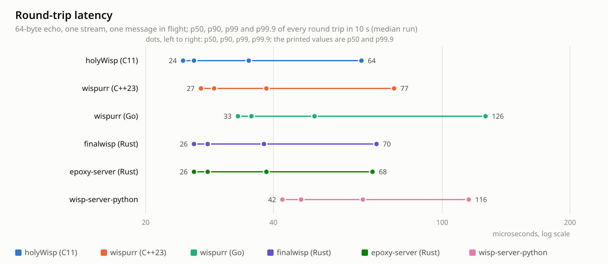

# holyWisp

[](https://www.npmjs.com/package/holywisp)
[](https://github.com/Fracital/holyWisp/actions/workflows/build.yml)
[](https://github.com/Fracital/holyWisp/issues)
[](https://github.com/Fracital/holyWisp/stargazers)

A [Wisp](https://github.com/MercuryWorkshop/wisp-protocol) server in C11 with no dependencies
beyond libc and pthreads, plus a C client library and CLI. Wisp v1 and v2 over WebSocket, TCP and
UDP relay, and the full wispurr-style security suite: flood protection, per-IP rate and bandwidth
limits, IP reputation, a default-deny egress policy, host and port filters, an optional upstream
proxy, and optional PTY terminal streams.

Powering [STomp](https://github.com/Fracital/powerMouse): its demo server embeds holyWisp through
the [npm package](node/README.md), and the public relay at `wss://holywisp.fracit.al/` is this
server.

## Quickstart

**Install the package** (Debian/Ubuntu or Fedora/RHEL). This creates the isolated `wisp` user and
starts a hardened systemd service listening on `127.0.0.1:6001`:

```sh
# Debian / Ubuntu
curl -fsSLO https://github.com/Fracital/holyWisp/releases/download/latest/holywisp_0.5.4-2_amd64.deb
sudo apt install ./holywisp_0.5.4-2_amd64.deb

# Fedora / RHEL
sudo dnf install https://github.com/Fracital/holyWisp/releases/download/latest/holywisp-0.5.4-2.fc41.x86_64.rpm

sudo systemctl status holywisp            # running as user "wisp", sandboxed
sudoedit /etc/holywisp/holywisp.conf      # then: sudo systemctl restart holywisp
```

**Only the client?** `holywisp-client` is its own package, with no service, user or config, for a
machine that only connects to Wisp servers (the server package no longer carries it; install both
for both):

```sh
# Debian / Ubuntu
curl -fsSLO https://github.com/Fracital/holyWisp/releases/download/latest/holywisp-client_0.5.4-2_amd64.deb
sudo apt install ./holywisp-client_0.5.4-2_amd64.deb

# Fedora / RHEL
sudo dnf install https://github.com/Fracital/holyWisp/releases/download/latest/holywisp-client-0.5.4-2.fc41.x86_64.rpm

# Any glibc 2.35+ Linux (x64 or arm64)
curl -fsSL https://github.com/Fracital/holyWisp/releases/download/latest/holywisp-client-linux-x64.tar.gz | tar xz
```

**Or grab a prebuilt binary** (x86_64 or arm64 Linux, glibc 2.35+). The `latest` link always
points at the newest `main` build:

```sh
curl -fsSL https://github.com/Fracital/holyWisp/releases/download/latest/holywisp-linux-x64.tar.gz | tar xz
cd holywisp-linux-x64 && ./holywisp --config holywisp.conf
```

**Or build from source** (CMake 3.20+, GCC 12+ or Clang, Linux):

```sh
make release                              # -> build/release/holywisp, holywisp-client
build/release/holywisp --port 6001 --allow-loopback
```

Then push data through it with the client, netcat-style:

```sh
printf 'GET / HTTP/1.0\r\nHost: example.org\r\n\r\n' \
  | build/release/holywisp-client -s ws://127.0.0.1:6001/ example.org 80
```

Downloads and checksums for every release: **https://github.com/Fracital/holyWisp/releases**.

## Build and test

Requires CMake 3.20+, GCC 12+ or Clang (the ChaCha20 kernels use `__builtin_shufflevector`) and
Linux (epoll). Ninja is used when present. `crypt(3)` and
`forkpty(3)` come from libc (`libcrypt-dev` / `libxcrypt-devel` on some distros).

It also builds and runs on macOS (kqueue), as a port for development machines: the same server and
the same tests, but payloads are copied where Linux splices them, the workers share one listening
socket, and `crypt(3)` there knows no `$5$`/`$6$` hashes. Production is Linux.

Windows is a third such port, and always a cross build (`make npm` makes it, with zig; `make
test-windows` runs the test suite under Wine). It is the same source: `src/compat/win32` supplies
the POSIX socket calls over Winsock and the loop waits in `select`. What Windows cannot do is
refused when the server starts, not discovered later: Twisp (no pseudo-terminal a loop can watch)
and hashed passwords (no `crypt(3)`). `holywisp-client` is not built there.

```sh
make            # debug build with ASan/UBSan -> build/debug
make test       # unit + end-to-end tests
make release    # optimised build -> build/release
make deb        # the server and client .debs -> build/packages/
make rpm        # the server and client .rpms -> build/packages/
make npm        # the npm package     -> node/bin, node/dist (needs zig)
make test-windows  # the Windows build and its tests under Wine (needs zig and wine)
make help
```

## Security features

Every limit is configurable and most are on by default, matching wispurr's shipped posture.

- **Default-deny egress.** Streams may only reach public unicast addresses. Loopback, RFC 1918,
  CGNAT, link-local, multicast, unspecified and reserved ranges are refused unless the matching
  `allow-*` is set. The check runs on the resolved addresses, after DNS, so a hostname that
  resolves to a private address is blocked. IPv4-mapped IPv6, NAT64 and 6to4 are unwrapped first.
- **Host and port filters.** `allow-host` / `block-host` (with `*.suffix` wildcards) and
  `allow-port` / `block-port` (single ports or ranges).
- **Flood protection.** Per-source-IP and per-destination connect-rate windows, in-flight-SYN and
  concurrent-connection caps both server-wide and per client address (so one client cannot take
  every slot), a per-connection stream cap, and a SYN-flood signature that watches the
  failed-connect ratio per destination and drops the client on a match.
- **Clients that stop reading.** A client that will not take what it asked for is no longer read
  from once its queue is at twice `ws-write-high-water`, and is closed after
  `client-write-timeout-s` without progress. `idle-timeout-s` closes a connection that has no
  open streams and has sent nothing for that long, if you want that.
- **Origin allowlist.** `allow-origin` restricts which web pages may open a connection through a
  visitor's browser. Unset, any page may, as a public relay needs.
- **Per-IP limits.** New-connection rate limiting per client IP and a per-IP bandwidth cap in both
  directions (a token-bucket pause, never a drop).
- **IP reputation.** A 0–100 score per source IP and per destination, raised by weighted events
  (auth failures, SYN signatures, burst rates, probing a terminal stream) and decayed over time.
  Only what a client does on its own account is scored: hitting a limit that all clients share,
  or asking for a private address (which any web page can make a browser do), is refused and
  counted but not held against the address. Tiers escalate from logging to tightening a client's limits to refusing
  it outright. Persisted as JSON and reloaded on restart.
- **Password auth (Wisp v2).** `password-user USER:PASS`, where `PASS` may be a `crypt(3)` hash
  (`$2b$`, `$6$`, `$y$`, …) checked in constant time, not only plaintext. Hashes are computed
  off the event loops, so a slow hash never stalls other clients. An empty password is refused.
- **Real client IP.** Honours `X-Forwarded-For` (and any other header you name with
  `trusted-header`, for a proxy that overwrites it), but only from trusted proxy CIDRs, taking the
  right-most untrusted address in the chain. `trusted-proxy-secret` additionally requires a
  shared secret on the request, for a proxy that shares its address with other local processes.
- **Upstream proxy and WARP routing.** `proxy` sends TCP through a SOCKS5 or HTTP CONNECT proxy,
  which is handed the hostname, after the egress check here. `proxy-only-to` sends only the
  streams that resolved to the given addresses there and dials the rest directly. The
  `udp-warp-*` and `tcp-warp*` keys mark each socket for the WARP tunnel an edge router would pick
  for its site, and `warp-bypass-host` keeps named sites off WARP. These are what the
  wisp.baby edges run.
- **WebSocket strictness.** Client frames must be masked; reserved bits, text frames and oversize
  messages are rejected per RFC 6455.
- **Hardened by default when installed.** The systemd unit runs as the unprivileged, shell-less
  `wisp` user with no capabilities, a read-only filesystem, a private `/tmp`, no raw devices, a
  locked-down syscall filter, `AF_INET`/`AF_INET6`-only sockets and `MemoryDenyWriteExecute`. A
  compromise of the process does not become a foothold on the host. `systemd-analyze security`
  rates it ~1.3 ("OK"). See `deploy/systemd/holywisp.service`.

TLS is not built in: terminate `wss://` at a reverse proxy (nginx, Caddy, Cloudflare).

## Configuration

Every option is a `--flag value` (or `--flag=value`) and a `flag = value` line in the config file;
flags override the file. Boolean flags may stand alone (`--allow-loopback`). `holywisp --help`
lists them all; `holywisp.conf.example` is the fully annotated reference.
`holywisp --config FILE --check-config` parses and checks a configuration the way a start would
(every cross-key rule, the proxy's host resolving, a WebTransport certificate and key loading as a
pair), binds nothing, prints no secret and exits 0 when the server would start with it, 1 when it
would not: a gate to run before a restart. The most important keys:

| Key | Default | What it does |
| --- | --- | --- |
| `host`, `port`, `workers` | `""`, `6001`, `0` | Bind address (all interfaces; the package default is `127.0.0.1`), port, worker threads (0 = per CPU) |
| `allow-tcp`, `allow-udp` | on | Stream types clients may open |
| `allow-direct-ip`, `allow-private`, `allow-loopback`, `allow-link-local` | off | Relax the egress policy |
| `allow-host` / `block-host`, `allow-port` / `block-port` | none | Destination allow/block lists |
| `enable-v2`, `motd` | on, `""` | Wisp v2 handshake, message of the day |
| `enable-twisp` | off | PTY terminal streams; needs v2 and an authenticated client |
| `stream-credit` | on | Offer stream credit in the v2 INFO (extension `0xE2`). A client that names it with a window grants each TCP or terminal stream its bytes as it reads them (CREDIT, packet `0xE2`), and the server reads that stream's remote no further than the grant, so a body nobody reads holds up only its own stream. Off leaves `0xE2` out of the INFO; a client that does not name it sees no difference |
| `upload-credit` | on | Offer upload credit in the v2 INFO (extension `0xE4`, [docs/extensions.md](docs/extensions.md)). A client that names it counts each TCP or terminal stream's uploads in bytes against a limit the server raises (UPLOAD_CREDIT, packet `0xE4`) once half a budget has reached the remote, instead of waiting for a CONTINUE at the end of each packet window. The budget is `upload-window` shared by the client's streams, within `stream-queue-max`. Off leaves `0xE4` out of the INFO; a client that does not name it sees no difference |
| `password-user USER:PASS`, `password-required` | none, off | v2 password auth (hash or plaintext); refuse unauthenticated clients |
| `trusted-proxy`, `trusted-header`, `trusted-proxy-secret` | none, `X-Forwarded-For`, none | Whose proxy headers name the client, which header, and a secret the proxy must also send |
| `parse-real-ip`, `trusted-headers-reset` | on, off | Read the client's address from a trusted proxy's header at all; empty the header list (`X-Forwarded-For`) before the `trusted-header` lines add theirs |
| `allow-origin` | none | Origins (`scheme://host[:port]`) a browser may connect from; none means any |
| `policy-file` | none | A file of more `allow-host`, `block-host`, `allow-port`, `block-port`, `warp-bypass-host` and `allow-origin` lines (and nothing else), in the config file's syntax, added to the config's own. Read again within a few seconds of a change, and once a minute in any case: new streams and upgrades see the new lists at once, open ones are not touched, and nobody is dropped. It must load when the server starts; later, a file that does not load (a bad line, another key, a list too full) or has gone is logged as an error and the lists in force stay. Replace it by rename, so it is never read half-written |
| `connections-limit-per-ip`, `connection-window-s` | 200, 10 | New WebSockets per IP per window |
| `max-streams-per-conn` | 2048 | Open streams one connection may hold (0 = unlimited); past it a CONNECT is throttled (`0x49`). A v2 client is told the cap in INFO (extension `0xE3`, [docs/extensions.md](docs/extensions.md)) |
| `max-concurrent-connections-per-ip`, `max-in-flight-syns-per-ip` | 5000, 512 | One client address's share of the server-wide connection and in-flight-connect caps |
| `max-handshakes-per-ip` | 128 | Connections from one address that have not yet sent their whole HTTP request head; one more is answered 429 and closed at accept. Counted by the socket's peer, so connections from a `trusted-proxy` are never counted (0 = unlimited; with `flood-protection`) |
| `client-write-timeout-s`, `idle-timeout-s` | 120, 0 | Close a client that takes nothing queued for it for this long; close a connection that has no open streams and has sent no frame for this long, with 1001 (0 = never) |
| `bandwidth-limit-kbps` | 0 | Per-IP bandwidth cap, each direction |
| `flood-protection` and its `max-*` / `syn-signature-*` keys | on | See `holywisp.conf.example` |
| `ws-close-after-violations`, `log-blocked-dials` | 64, off | Close a client after this many flood-limit hits of its own (0 = never); log every failed dial at `info`, with the client address |
| `reputation` and its `reputation-*` keys | on | IP reputation scoring and persistence |
| `proxy` | `""` | Upstream `socks5://` (or `socks5h://`) / `http://` proxy for outbound TCP; it is given the destination hostname |
| `proxy-only-to` | none | With a proxy, only a TCP stream that resolved to one of these addresses or CIDRs goes through it (by name, as always); every other TCP stream is dialled here. Repeatable. None: every TCP stream takes the proxy. For a router whose DNS gate answers the names it must handle itself with one address, which may be a private one: a name that resolves to a listed address is not refused for its address class, since the proxy gets the name |
| `proxy-udp` | `refuse` | With a proxy: `refuse` UDP streams, or relay them `direct`, bypassing the proxy |
| `udp-warp-marks`, `udp-warp-state` | `""`, `""` | UDP through WARP tunnels (Linux, needs `CAP_NET_ADMIN`): each UDP socket gets the fwmark of the tunnel the edge router would send its site through, chosen by the same rendezvous hash over the tunnels the state file (the router's JSON) lists as healthy, so a site's UDP leaves from the same exit as its TCP. The marks are the ones the file may choose from. Both or neither. Without the capability the server still starts, and says that its UDP goes out unmarked |
| `udp-warp-state-max-age-s` | 60 | A state file not rewritten for longer is ignored, and UDP goes out unmarked (0: never too old). The same holds for a file that is missing or malformed |
| `proxy-client-key` | off | Choose the exit per client and site instead of per site: the proxy gets a key for each client as its user name (SOCKS5 offers both "none" and username/password, so a proxy that reads no credentials is unaffected; the password stays the URL's), and the UDP WARP pick hashes `key/site`. The key is 16 hex digits of BLAKE2b over the secret and the client's address (an IPv6 client's /64), never the address |
| `proxy-client-key-secret` | random | What the keys are made with, at least 16 characters, never logged. Unset, it is drawn at each start, and a restart then moves every client to another exit |
| `udp-warp-fallback` | `refuse` | The state file lists no healthy tunnel for the stream's address family: `refuse` the stream (`0x42`), or send it `direct`, unmarked |
| `tcp-warp` | off | Mark the TCP streams dialled here (no proxy, or not in `proxy-only-to`) from the same state and with the same pick as UDP. Needs `udp-warp-marks` and `udp-warp-state` |
| `warp-bypass-host` | none | A name whose streams never go through WARP: UDP and TCP dialled here go out unmarked, whatever the state or the fallbacks say. `example.com` matches exactly, `*.example.com` its subdomains. Repeatable. Give the router the same list for the TCP it dials, or the site sees two addresses |
| `tcp-warp-fallback` | `refuse` | A TCP stream with no usable state (missing, stale), no tunnel for its family, or a mark that cannot be set: `refuse` it (`0x42`; another address of the name is tried first), or send it `direct`, unmarked |
| `dns-server`, `dns-ttl-s`, `dns-order`, `dns-timeout-ms` | system, 120, ipv4first, 3000 | Built-in resolver and cache |
| `dns-negative-ttl-s`, `resolver-threads` | 10, 4 | How long a failed lookup is cached; threads that run lookups (`getaddrinfo`, or the built-in client with `dns-server`, which asks A and AAAA at once) |
| `max-pending-lookups-per-ip` | 128 | Lookups one client address may have in the resolver at once (waiting for a thread, running, or still running for a stream that closed); one more CONNECT is closed `0x49` and counts as a violation. Applies whether or not `flood-protection` is on. Whatever it says, the threads go to the client addresses in turn and one address never holds all of them, so a client asking for names that never resolve delays another client's lookup by at most one lookup (0 = no limit) |
| `family-fallback-ms` | 3000 | A TCP connect that still has an address of the other family to try gives up after this, not after `connect-timeout-ms`, so a name with broken IPv6 is no 15 s wait. Families are tried in turn, never raced, so TCP and UDP land on one (0 = off) |
| `buffer-remaining`, `max-message-size`, `ws-write-high-water` | 128, 1 MiB+5, 8 MiB | Flow control and the queue toward a slow client; the advertised window is capped so a full window of max-size packets fits in `stream-queue-max` |
| `upload-window` | 0 | Bytes one client may have in flight toward its remotes, shared by its streams: a refill CONTINUE grants that budget over the client's streams in packets of the size it sends (at least 4). 0 uses `ws-write-high-water`. Raise it for fast uploads over a long path when the mark is kept short for latency; `conn-queue-max` still bounds what queues |
| `socket-buffer-size`, `client-recv-buffer` | 0, 8 MiB | `socket-buffer-size` sets `SO_RCVBUF`/`SO_SNDBUF` on every socket (0 leaves them to the kernel). Otherwise client sockets get a receive buffer of `client-recv-buffer`, but only when `net.core.rmem_max` grants at least 4 MiB (the kernel doubles the value, so `rmem_max` of 2 MiB or more); 0 turns that off |
| `stream-queue-max`, `conn-queue-max` | 128 MiB, 256 MiB | Bytes queued toward slow remotes: per stream (the stream closes `0x49` beyond it) and per client (its reads pause beyond it and resume at half) |
| `server-queue-max`, `server-queue-max-per-ip` | 4 GiB, 1 GiB | Bytes queued toward clients and toward remotes by all connections together, and by those of one client IP (0 = no limit). A connection that would queue past either stops reading its client and its remotes until its own queues drain or the budget frees; nothing is closed or dropped. Counted in whole MiB per connection, so a connection queueing less than 1 MiB never waits for it. `/stats` shows `queueBudget.held` and `.pauses` |
| `handshake-timeout-ms`, `listen-backlog` | 10000, 1024 | Time a new connection has to finish its upgrade (on Wisp v2, its INFO exchange too); the listen queue length |
| `tcp-nodelay`, `tcp-quickack` | on, on | `TCP_NODELAY` and `TCP_QUICKACK` on client and remote TCP sockets |
| `non-ws-response` | a one-line notice | Body for a plain HTTP request that is not an upgrade, `/health` or `/stats` (empty: 426) |
| `busy-poll-us` | 0 | After a loop iteration that had events, poll this many microseconds before sleeping: lower round-trip latency under load, more CPU spent waiting. 0 always sleeps |
| `serve-webclient` | on | Serve the built-in browser client on `GET /` |
| `webclient-wisp-url` | empty | `ws(s)://` URL the web client offers by default; empty means the page's own origin |
| `webtransport` | off | Also listen for [WebTransport](docs/webtransport.md) (HTTP/3 over QUIC, on UDP): Wisp over a session, the same packets, limits and policy, with UDP streams on QUIC datagrams. TLS 1.3 for this listener is in-tree |
| `webtransport-host`, `webtransport-port` | `host`, `port` | UDP address and port the WebTransport listener binds (by default the TCP listener's own address and port number) |
| `webtransport-url` | empty | `https://` URL that `GET /webtransport.json` names, for a page that should not derive it from its own origin |
| `webtransport-cert-dir` | empty | A directory of `<host>.pem` files, each a certificate chain and its ECDSA P-256 key in one file, named by the host in lower case. A client whose SNI is one of those names gets that certificate, any other name the one above. Read again when it changes (once a second for the directory, once a minute for every file, a file replaced by rename at once); a file that does not load is logged and that host gets the default. An unreadable directory keeps the server from starting |
| `webtransport-path` | every path | `[host] /path`, repeatable: a session request is admitted only when a rule names its `:path` (that path and anything under it; `/` names `/` alone) and, when the rule has one, its `:authority`'s host. Any other is answered 404 before anything is counted. For a relay that sits behind keyed paths on its WebSocket side. The value is never logged |
| `webtransport-cert`, `webtransport-key` | empty | PEM certificate chain and ECDSA P-256 key to use instead of the self-signed certificate, read again within a few seconds when either file changes: a renewal (certbot, lego) needs no restart, new sessions get the new certificate, open ones keep theirs, and a pair that does not load is logged and leaves the current one in use. Without them the server makes a P-256 certificate valid for 13 days and renews it every 6, and `GET /webtransport.json` lists the SHA-256 of the current and the previous one for `serverCertificateHashes` |
| `webtransport-reset-key-file` | empty | A file that keeps the QUIC stateless-reset key across restarts: 64 hex digits, made owner-only (0600) when it is missing, never overwritten when it holds anything else (that is logged, and the key is then new for this start). With it, the clients of a server that went away without closing their sessions (a crash, a kill) are told at once by the next one, whose stateless resets they then believe; empty, the key is new at each start and they wait for their idle timeout. A stop closes every session either way. One file per server: the key forges resets for that server's connection IDs |
| `webtransport-idle-timeout-s` | 30 | QUIC idle timeout; the server sends a keepalive PING after 20 s without sending |
| `webtransport-max-handshakes`, `webtransport-retry-threshold` | 1024, 64 | QUIC handshakes in progress per worker; past the threshold every new Initial gets a Retry, so the client must prove its address first |
| `webtransport-congestion-control` | `bbr` | `bbr`, `bbr2` or `newreno`: QUIC's congestion control toward the client. BBR paces at the bandwidth it measures and does not slow down for a random loss; `bbr2` is BBR with version 3's answer to loss: a round that loses more than 2% ends startup or a probe and bounds what it keeps in flight to where the loss began, and it probes above that only every 2 to 3 s, so behind a shallow buffer it loses a fraction of what BBR does (a random loss under 2% still changes nothing); NewReno (RFC 9002) halves its window at every one, and on a path that loses 0.3% runs at a tenth of the same path's TCP |
| `webtransport-lanes` | 8 | How many bidirectional QUIC streams (lanes) one v2 session may spread its Wisp streams over, so that a loss or a slow reader on one holds up only the streams on that lane; the server advertises it in INFO (extension `0xE1`). 0 or 1 turns lanes off; at most 16. A client that offers the protocol `wisp-v2-server-stream` also gets its Wisp stream opened by the server, with the stream-0 CONTINUE sent at once (docs/webtransport.md) |
| `log-level` | `info` | `debug`, `info`, `warn`, `error`, `none`. While the server runs, SIGUSR1 makes it one level more verbose and SIGUSR2 one level less (never quieter than `error`); each change is logged. Not on Windows, which has no such signals |
| `stop-on-stdin-eof` | off | Shut down when standard input reaches end of file. For a program that runs `holywisp` as a child with a pipe on its stdin (the Node wrapper does): the server then never outlives its parent. Leave it off under systemd, where stdin is `/dev/null` |

`GET /health` returns `{"status":"ok"}` and `GET /stats` returns the counters (connections,
streams, bytes, and every refusal/throttle/block tally), both on the same port. `/stats` also
names the running build (`version`) and, as `warpState`, what the WARP state file means at the
last look: `configured`, `canMark` (the process may mark sockets), `usable`, `state` (`ok`,
`missing`, `unreadable`, `malformed`, `stale`, `noCapability` or `off`), `ageSeconds` since the
router last rewrote it and the usable `tunnels` per family. `connections.total` counts every
socket, `/health` and `/stats` polls included; `connections.webSocket` and
`connections.webTransport` count the Wisp clients by transport and `connections.httpReplies` the
plain HTTP answers. `webTransport.quic` sums what QUIC counted over the sessions that have ended
(packets sent, received and lost, spurious losses, bytes, congestion events, PTOs, and the sum of
each session's last smoothed RTT). `streamEnds` says why streams ended, by the close reason the
server sent: `ended` once open (the remote's end, an error, a full queue), `failed` before they
opened (resolving, the egress policy, the destination limits, the dial, the proxy), `refused` for
a CONNECT turned away before it was a stream, and the client's own `clientClose` and
`connectionEnd`, each `beforeOpen` and `afterOpen`. `timing` holds histograms (`count`, `sumUs`,
and `buckets` up to each of `boundsMs`, the last for the rest) of resolving, of connecting (from
the first dial to open, the proxy's handshake included) and of the first remote byte (from the
later of open and the client's first DATA), for TCP dialled here, TCP through the proxy and UDP.
`warpTunnels` has the same per `udp-warp-marks` tunnel, by its position there and the router's
name for it (never the mark), with the TCP connects that failed. Fields are only ever added. With
`webtransport`, `GET /webtransport.json` on that port is `{"url": ..., "hashes": [...]}`: the URL
to open (`webtransport-url`, or `""`) and the certificate hashes a page passes to
`new WebTransport(url, {serverCertificateHashes})`.

## Running as a service

The packages install and start the unit for you. To run it by hand from a source build:

```sh
sudo useradd -r -g wisp -d /var/lib/holywisp -s /usr/sbin/nologin wisp   # or let the package do it
sudo install -m0755 build/release/holywisp /usr/bin/holywisp
sudo install -Dm0644 deploy/systemd/holywisp.service /etc/systemd/system/holywisp.service
sudo install -Dm0640 deploy/holywisp.conf /etc/holywisp/holywisp.conf
sudo systemctl daemon-reload && sudo systemctl enable --now holywisp
```

The config may hold password hashes, so it is `root:wisp` mode `0640`, never world-readable. State
(the reputation store) lives in `/var/lib/holywisp`, owned by `wisp`.

The config is read once, and there is no reload (`systemctl reload` is refused): a change takes a
restart. The log level is the exception: `sudo systemctl kill -s USR1 holywisp` makes the log one
level more verbose, `-s USR2` one level less, without dropping a client.

## Terminal streams (Twisp)

With `enable-twisp = on` and an authenticated v2 client, a `CONNECT` of stream type `0x03` runs the
command in its hostname field on a pseudo-terminal and relays it as a stream. This is a remote
shell by design, so it is off by default and gated behind the enable flag **and** a password
login; the systemd sandbox still contains whatever it spawns. Leave it off unless you need it.

## Client

`holywisp-client` is netcat through a Wisp server:

```sh
# UDP, wisp-v2 with a password
build/release/holywisp-client -s ws://wisp.example:6001/ --udp --user me --pass secret 1.1.1.1 53

# throughput against a TCP echo service
build/release/holywisp-client --bench 268435456 echo.example 7

# the same over WebTransport, pinned to the certificate hash /webtransport.json lists
build/release/holywisp-client -s https://wisp.example:6001/ --pin <base64 sha-256> example.org 80
```

`--credit BYTES` asks a v2 server for stream credit with an initial window of `BYTES` per stream:
the server then sends each TCP stream only what this client has read and one window more, and the
client grants more as it reads (a CREDIT once it has read half a window). `--read-rate BPS` makes
the client read what arrives no faster than `BPS` bytes a second, a slow reader; with `--credit`
that holds the server, and the remote behind it, to that rate. Over `--bench` with `--credit`, each
stream keeps at most half a window in flight, so the window bounds the rate as it does natively.
`--upload-credit` asks a v2 server for upload credit (extension `0xE4`): the client's sends on each
TCP stream are counted in bytes against the limit the server raises as its remote takes them,
instead of CONTINUE's window of packets.

An `https://` server URL is WebTransport (UDP, port 443 unless the URL says otherwise). There is no
certificate authority check: `--pin` (the SHA-256 in base64 or hex) is what authenticates the
server, and `--insecure` takes any certificate, for loopback tests. `--origin` sends an origin
header, for a server with `allow-origin`. `--connect-to ADDR` sends the datagrams to `ADDR` while the
URL's host stays the SNI and `:authority`, as curl's option of that name does: one host of a server
with `webtransport-cert-dir`, reached by its address. `--udp-buffer N` sets the UDP socket's buffers
(4 MiB by default); `--udp-buffer 212992` receives as a browser does on a Linux with stock settings,
which is how a server's bursts are tested against a receive buffer that small.

The library behind it is `include/holywisp/client.h`: connect, open streams, send, poll events
(`hw_client_opts.webtransport` for WebTransport). `tests/test_e2e.c`, `tests/test_e2e_wt.c` and
`tests/test_security.c` are the reference for using it.

## Browser demo

`examples/wisp-webclient.html` is a dependency-free, single-file browser client styled with the
Holo theme. The server serves it on `GET /` by default (`serve-webclient`), so just open the
server's URL in a browser; the page defaults its Wisp field to that same origin. You can also open
the file directly. It confirms a server works interactively: it does the Wisp handshake, opens
one TCP stream to a destination, sends a plain HTTP request, and prints the response plus a
per-packet trace. The **Wisp server URL** field is front-and-center so you can point it at a local
`ws://127.0.0.1:6001/` or an external `wss://wisp.example.com/` domain.

Two toggles, both on by default:

- **UDP** carries Wisp over WebTransport (HTTP/3 on QUIC, so UDP) instead of a WebSocket. The page
  reads the relay's `/webtransport.json`: pinned hashes, or none for a Web PKI certificate, and the
  URL to dial, where `""` means the relay's own host and port. It races WebTransport against a
  WebSocket. WebTransport gets a 1 s head start, and the WebSocket starts at once if WebTransport
  fails. The first to finish the Wisp handshake wins, and the winner is remembered per relay: a
  WebSocket win keeps WebTransport off for that relay for an hour. A browser without WebTransport,
  or a relay without the JSON, uses the WebSocket. With UDP off, the WebSocket is used alone.
- **Wisp v2** shows the server's extensions and MOTD, and asks for stream confirmation.

The request to the target is a TCP stream from the relay either way; the toggle chooses only how
the page reaches the relay. The default target is `http://api.ipify.org/`.

## Node.js

`node/` is an npm package, `holywisp`, that embeds the server in a Node.js application the way
[wispurr](https://github.com/sylvieisnton/wispurr)'s wrapper does, with the same class shape and
option names: it carries a binary for Linux (x64 and arm64, statically linked), macOS and Windows
(x64 and arm64 each), starts it as a child process and routes the WebSocket upgrades of your own
HTTP server to it. A server that dies is started again, and it never outlives the process that
started it. A Vite plugin is included.

```sh
npm install holywisp            # the newest release
npm install holywisp@nightly    # the newest commit of master that passed its tests
```

A release is a `v<version>` tag. Master is published every night as `holywisp@nightly`: a version
reads `0.5.4-nightly.202611110643.g1a2b3c4` (the version in `node/package.json`, the UTC time, the
commit), and `holywisp --version` inside it says the same. A commit is published once, only after
`Build` passed on it and the tarball was installed and run on every platform it carries. Both come
from CI without a stored token (npm trusted publishing) and with provenance. Pin the exact nightly
an application was tested with.

```ts
import { createServer } from "node:http";
import { holyWisp } from "holywisp";

const wisp = new holyWisp();
await wisp.start(4); // four worker threads behind one port

const server = createServer();
server.on("upgrade", (req, socket, head) => wisp.route(req, socket, head));
server.listen(8080);
```

`route()` passes the client's address on, so the per-client limits and the reputation table keep
working behind it. [`node/README.md`](node/README.md) has the API, the option table and what
differs from wispurr. `make npm` builds the package and `make npm-test` runs its tests.

## Benchmarks

`bench/` holds a wispmark-style harness that runs holyWisp, finalwisp, epoxy-server, both wispurr
implementations and wisp-server-python on the same host, through the same echo service, driven by
the same clients. Full tables are in [bench/RESULTS.md](bench/RESULTS.md); the method and how to
rerun it are in [bench/README.md](bench/README.md). These are the medians of twelve 10 s runs in a
container with 8 CPUs (four cores of a Ryzen 9 7950X with both hardware threads each, CT 122 on
divide), in MiB/s through the echo port, with the best server in each row in bold.

| scenario | holyWisp | finalwisp | wispurr C++23 | wispurr Go | epoxy-server | wisp-server-python |
| --- | --- | --- | --- | --- | --- | --- |
| wisp-js, 10 streams | 1,325 | **1,380** | 1,091 | 1,192 | 732 | 800 |
| wisp-js, 5 connections x 10 streams | **2,225** | 2,029 | 1,792 | 1,460 | 1,265 | 1,132 |
| native client, 1 stream | 3,813 | 3,532 | **3,861** | 2,603 | 994 | 767 |
| native client, 10 streams | **3,462** | 3,256 | 3,274 | 2,427 | 1,003 | 839 |
| native client, 10 streams, 1 MiB packets | 3,005 | **3,537** | 2,985 | 2,545 | 1,127 | did not finish |
| native client, 8 connections x 4 streams | 4,466 | **4,705** | 3,700 | 2,002 | 3,073 | 2,024 |
| 64 B round trip, p50 / p99 | **24.5 / 35 us** | 26 / 38 us | 27 / 38.5 us | 33 / 50 us | 26 / 38.5 us | 42 / 65 us |
| stream churn, lifecycles/ s (server cores) | **114,439** (4.5) | 111,342 (4.2) | 95,897 (4.3) | 63,738 (5.2) | 70,918 (4.6) | 36,816 (4.9) |
| peak RSS under stream churn | 3.7 MiB | **3.5 MiB** | 22 MiB | 494 MiB | 2,502 MiB | 298 MiB |

holyWisp, finalwisp and the C++23 wispurr are the three fastest servers here, and each leads
somewhere. holyWisp leads behind five wisp-js connections by 10% over finalwisp, with 10 native
streams on one connection by 6% over both of the others, on the round trip at every percentile,
and at opening and closing streams by 3% over finalwisp and 19% over the C++23 wispurr. finalwisp
leads with 8 connections by 5% and with 1 MiB packets by 18%, and behind one wisp-js connection by
4%. The C++23 wispurr leads with one native stream, by 1%, inside the noise.

The 8-connection row fills the container: the servers' threads share four cores with eight load
generators and the echo service, so it measures how a server shares a full box as much as what it
costs per byte. holyWisp and finalwisp relay within 2% of each other per CPU-second there, and
finalwisp's lead is the 6% more CPU it kept busy. With 1 MiB packets the three fastest servers also
cost the same per byte; holyWisp and the C++23 wispurr kept 0.84 and 0.83 cores busy to finalwisp's
0.97, so that gap is time spent waiting, not work. Per CPU-second holyWisp is the cheapest server
in four of the six throughput rows and the C++23 wispurr in the other two, and holyWisp and
finalwisp both stay under 4 MiB of memory under churn.

epoxy-server, the Rust server that epoxy's Wisp client is made for, relays 57 to 65% of the
leader's throughput with several connections, 26 to 32% of it with the native client on one
connection, and 62% of the leader's streams per second under churn. It relays 450 to 820 MiB per
CPU-second where holyWisp relays 1,420 to 3,840, and its memory passed 2 GiB under churn.

Results move with the host. On the 16-vCPU Xeon Gold 6348 VM of the previous run (2026-11-16),
holyWisp led with 8 connections, the C++23 wispurr led on one native connection by 12 to 13%, and
round trips took three times as long; [bench/RESULTS.md](bench/RESULTS.md) compares the two runs.

<picture>
  <source media="(prefers-color-scheme: dark)" srcset="bench/charts/throughput-dark.png">
  
</picture>

<picture>
  <source media="(prefers-color-scheme: dark)" srcset="bench/charts/efficiency-dark.png">
  
</picture>

<picture>
  <source media="(prefers-color-scheme: dark)" srcset="bench/charts/latency-dark.png">
  
</picture>

## Layout

```
include/holywisp/   public headers
src/common/         buffers, logging, event loop (epoll, kqueue, select), resolver, DNS client+cache, rate
                    limiters, reputation, string/int maps, filters, WebSocket + Wisp codecs
src/compat/win32/   Windows only: the POSIX socket calls over Winsock, under their POSIX names
src/server/         holywisp: config, workers, connections, streams, egress, upstream proxy, twisp,
                    the WebTransport listener
src/quic/           TLS 1.3, QUIC, HTTP/3 and WebTransport, sans-IO, for the WebTransport listener
src/client/         libholywisp-client and the holywisp-client CLI
tests/              one binary per module plus the end-to-end and security suites, run by ctest
deploy/             systemd unit, Debian + RPM packaging, the package builder
examples/           wisp-webclient.html: a single-file browser client for interactive testing
node/               the npm package: the Node.js wrapper, its tests and build script
bench/              the comparison harness, its results and charts (make bench)
.github/workflows/  build, format, release (binaries), packages (.deb + .rpm)
```

`STYLE.md` has the coding rules, `AGENTS.md` the rules for anyone (human or agent) changing the
repository, and `LICENSE` the MIT terms.

## Credits

| | GitHub | Name |
| --- | --- | --- |
|  | [@e9x](https://github.com/e9x) | David Reed |
