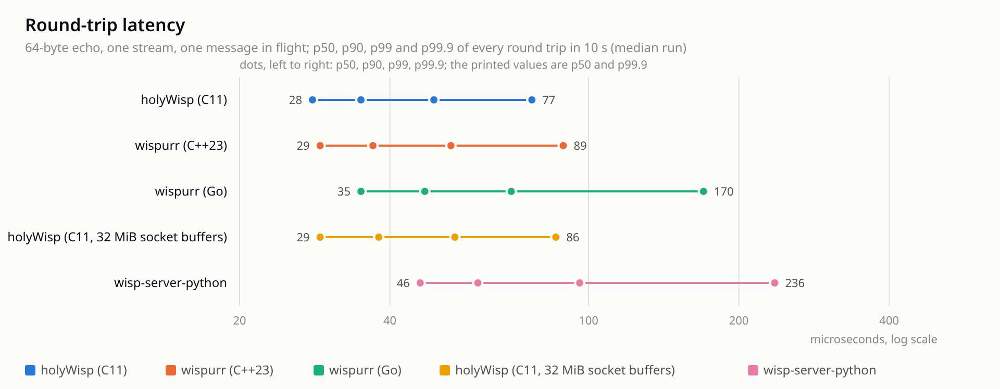

# holyWisp

[](https://www.npmjs.com/package/holywisp)
[](https://github.com/Fracital/holyWisp/actions/workflows/build.yml)
[](https://github.com/Fracital/holyWisp/issues)
[](https://github.com/Fracital/holyWisp/stargazers)

A [Wisp](https://github.com/MercuryWorkshop/wisp-protocol) server in C11 with no dependencies
beyond libc and pthreads, plus a C client library and CLI. Wisp v1 and v2 over WebSocket, TCP and
UDP relay, and the full wispurr-style security suite: flood protection, per-IP rate and bandwidth
limits, IP reputation, a default-deny egress policy, host and port filters, an optional upstream
proxy, and optional PTY terminal streams.

## Quickstart

**Install the package** (Debian/Ubuntu or Fedora/RHEL). This creates the isolated `wisp` user and
starts a hardened systemd service listening on `127.0.0.1:6001`:

```sh
# Debian / Ubuntu
curl -fsSLO https://github.com/Fracital/holyWisp/releases/download/latest/holywisp_0.1.0_amd64.deb
sudo apt install ./holywisp_0.1.0_amd64.deb

# Fedora / RHEL
sudo dnf install https://github.com/Fracital/holyWisp/releases/download/latest/holywisp-0.1.0-1.fc41.x86_64.rpm

sudo systemctl status holywisp            # running as user "wisp", sandboxed
sudoedit /etc/holywisp/holywisp.conf      # then: sudo systemctl restart holywisp
```

**Or grab a prebuilt binary** (x86_64 or arm64 Linux, glibc 2.35+). The `latest` link always
points at the newest `main` build:

```sh
curl -fsSL https://github.com/Fracital/holyWisp/releases/download/latest/holywisp-linux-x64.tar.gz | tar xz
cd holywisp-linux-x64 && ./holywisp --config holywisp.conf
```

**Or build from source** (CMake 3.20+, a C11 compiler, Linux):

```sh
make release                              # -> build/release/holywisp, holywisp-client
build/release/holywisp --port 6001 --allow-loopback
```

Then push data through it with the client, netcat-style:

```sh
printf 'GET / HTTP/1.0\r\nHost: example.org\r\n\r\n' \
  | build/release/holywisp-client -s ws://127.0.0.1:6001/ example.org 80
```

Downloads and checksums for every release: **https://github.com/Fracital/holyWisp/releases**.

## Build and test

Requires CMake 3.20+, a C11 compiler and Linux (epoll). Ninja is used when present. `crypt(3)` and
`forkpty(3)` come from libc (`libcrypt-dev` / `libxcrypt-devel` on some distros).

It also builds and runs on macOS (kqueue), as a port for development machines: the same server and
the same tests, but payloads are copied where Linux splices them, the workers share one listening
socket, and `crypt(3)` there knows no `$5$`/`$6$` hashes. Production is Linux.

Windows is a third such port, and always a cross build (`make npm` makes it, with zig; `make
test-windows` runs the test suite under Wine). It is the same source: `src/compat/win32` supplies
the POSIX socket calls over Winsock and the loop waits in `select`. What Windows cannot do is
refused when the server starts, not discovered later: Twisp (no pseudo-terminal a loop can watch)
and hashed passwords (no `crypt(3)`). `holywisp-client` is not built there.

```sh
make            # debug build with ASan/UBSan -> build/debug
make test       # unit + end-to-end tests
make release    # optimised build -> build/release
make deb        # build a .deb        -> build/packages/
make rpm        # build an .rpm       -> build/packages/
make npm        # the npm package     -> node/bin, node/dist (needs zig)
make test-windows  # the Windows build and its tests under Wine (needs zig and wine)
make help
```

## Security features

Every limit is configurable and most are on by default, matching wispurr's shipped posture.

- **Default-deny egress.** Streams may only reach public unicast addresses. Loopback, RFC 1918,
  CGNAT, link-local, multicast, unspecified and reserved ranges are refused unless the matching
  `allow-*` is set. The check runs on the resolved addresses, after DNS, so a hostname that
  resolves to a private address is blocked. IPv4-mapped IPv6, NAT64 and 6to4 are unwrapped first.
- **Host and port filters.** `allow-host` / `block-host` (with `*.suffix` wildcards) and
  `allow-port` / `block-port` (single ports or ranges).
- **Flood protection.** Per-source-IP and per-destination connect-rate windows, a server-wide
  in-flight-SYN cap and concurrent-connection cap, a per-connection stream cap, and a SYN-flood
  signature that watches the failed-connect ratio per destination and drops the client on a match.
- **Per-IP limits.** New-connection rate limiting per client IP and a per-IP bandwidth cap in both
  directions (a token-bucket pause, never a drop).
- **IP reputation.** A 0–100 score per source IP and per destination, raised by weighted events
  (auth failures, SYN signatures, burst rates, probing a terminal stream, private-egress attempts)
  and decayed over time. Tiers escalate from logging to tightening a client's limits to refusing
  it outright. Persisted as JSON and reloaded on restart.
- **Password auth (Wisp v2).** `password-user USER:PASS`, where `PASS` may be a `crypt(3)` hash
  (`$2b$`, `$6$`, `$y$`, …) checked in constant time, not only plaintext.
- **Real client IP.** Honours `X-Forwarded-For` / `CF-Connecting-IP` and the like, but only from
  trusted proxy CIDRs, taking the right-most untrusted address in the chain.
- **WebSocket strictness.** Client frames must be masked; reserved bits, text frames and oversize
  messages are rejected per RFC 6455.
- **Hardened by default when installed.** The systemd unit runs as the unprivileged, shell-less
  `wisp` user with no capabilities, a read-only filesystem, a private `/tmp`, no raw devices, a
  locked-down syscall filter, `AF_INET`/`AF_INET6`-only sockets and `MemoryDenyWriteExecute`. A
  compromise of the process does not become a foothold on the host. `systemd-analyze security`
  rates it ~1.3 ("OK"). See `deploy/systemd/holywisp.service`.

TLS is not built in: terminate `wss://` at a reverse proxy (nginx, Caddy, Cloudflare).

## Configuration

Every option is a `--flag value` (or `--flag=value`) and a `flag = value` line in the config file;
flags override the file. Boolean flags may stand alone (`--allow-loopback`). `holywisp --help`
lists them all; `holywisp.conf.example` is the fully annotated reference. The most important keys:

| Key | Default | What it does |
| --- | --- | --- |
| `host`, `port`, `workers` | `""`, `6001`, `0` | Bind address (all interfaces; the package default is `127.0.0.1`), port, worker threads (0 = per CPU) |
| `allow-tcp`, `allow-udp` | on | Stream types clients may open |
| `allow-direct-ip`, `allow-private`, `allow-loopback`, `allow-link-local` | off | Relax the egress policy |
| `allow-host` / `block-host`, `allow-port` / `block-port` | none | Destination allow/block lists |
| `enable-v2`, `motd` | on, `""` | Wisp v2 handshake, message of the day |
| `enable-twisp` | off | PTY terminal streams; needs v2 and an authenticated client |
| `password-user USER:PASS`, `password-required` | none, off | v2 password auth (hash or plaintext); refuse unauthenticated clients |
| `connections-limit-per-ip`, `connection-window-s` | 200, 10 | New WebSockets per IP per window |
| `bandwidth-limit-kbps` | 0 | Per-IP bandwidth cap, each direction |
| `flood-protection` and its `max-*` / `syn-signature-*` keys | on | See `holywisp.conf.example` |
| `reputation` and its `reputation-*` keys | on | IP reputation scoring and persistence |
| `proxy` | `""` | Upstream `socks5://` (or `socks5h://`) / `http://` proxy for outbound TCP; it is given the destination hostname |
| `proxy-udp` | `refuse` | With a proxy: `refuse` UDP streams, or relay them `direct`, bypassing the proxy |
| `dns-server`, `dns-ttl-s`, `dns-order`, `dns-timeout-ms` | system, 120, ipv4first, 3000 | Built-in resolver and cache |
| `buffer-remaining`, `max-message-size`, `ws-write-high-water` | 128, 1 MiB+5, 8 MiB | Flow control and the queue toward a slow client; the advertised window is capped so a full window of max-size packets fits in `stream-queue-max` |
| `socket-buffer-size`, `client-recv-buffer` | 0, 8 MiB | `socket-buffer-size` sets `SO_RCVBUF`/`SO_SNDBUF` on every socket (0 leaves them to the kernel). Otherwise client sockets get a receive buffer of `client-recv-buffer`, but only when `net.core.rmem_max` grants at least 4 MiB (the kernel doubles the value, so `rmem_max` of 2 MiB or more); 0 turns that off |
| `stream-queue-max`, `conn-queue-max` | 128 MiB, 256 MiB | Bytes queued toward slow remotes: per stream (the stream closes `0x49` beyond it) and per client (its reads pause beyond it and resume at half) |
| `busy-poll-us` | 0 | After a loop iteration that had events, poll this many microseconds before sleeping: lower round-trip latency under load, more CPU spent waiting. 0 always sleeps |
| `serve-webclient` | on | Serve the built-in browser client on `GET /` |
| `webclient-wisp-url` | empty | `ws(s)://` URL the web client offers by default; empty means the page's own origin |
| `log-level` | `info` | `debug`, `info`, `warn`, `error`, `none` |
| `stop-on-stdin-eof` | off | Shut down when standard input reaches end of file. For a program that runs `holywisp` as a child with a pipe on its stdin (the Node wrapper does): the server then never outlives its parent. Leave it off under systemd, where stdin is `/dev/null` |

`GET /health` returns `{"status":"ok"}` and `GET /stats` returns the counters (connections,
streams, bytes, and every refusal/throttle/block tally), both on the same port.

## Running as a service

The packages install and start the unit for you. To run it by hand from a source build:

```sh
sudo useradd -r -g wisp -d /var/lib/holywisp -s /usr/sbin/nologin wisp   # or let the package do it
sudo install -m0755 build/release/holywisp /usr/bin/holywisp
sudo install -Dm0644 deploy/systemd/holywisp.service /etc/systemd/system/holywisp.service
sudo install -Dm0640 deploy/holywisp.conf /etc/holywisp/holywisp.conf
sudo systemctl daemon-reload && sudo systemctl enable --now holywisp
```

The config may hold password hashes, so it is `root:wisp` mode `0640`, never world-readable. State
(the reputation store) lives in `/var/lib/holywisp`, owned by `wisp`.

## Terminal streams (Twisp)

With `enable-twisp = on` and an authenticated v2 client, a `CONNECT` of stream type `0x03` runs the
command in its hostname field on a pseudo-terminal and relays it as a stream. This is a remote
shell by design, so it is off by default and gated behind the enable flag **and** a password
login; the systemd sandbox still contains whatever it spawns. Leave it off unless you need it.

## Client

`holywisp-client` is netcat through a Wisp server:

```sh
# UDP, wisp-v2 with a password
build/release/holywisp-client -s ws://wisp.example:6001/ --udp --user me --pass secret 1.1.1.1 53

# throughput against a TCP echo service
build/release/holywisp-client --bench 268435456 echo.example 7
```

The library behind it is `include/holywisp/client.h`: connect, open streams, send, poll events.
`tests/test_e2e.c` and `tests/test_security.c` are the reference for using it.

## Browser demo

`examples/wisp-webclient.html` is a dependency-free, single-file browser client styled with the
Holo theme. The server serves it on `GET /` by default (`serve-webclient`), so just open the
server's URL in a browser; the page defaults its Wisp field to that same origin. You can also open
the file directly. It confirms a server works interactively: it does the Wisp handshake, opens
one TCP stream to a destination, sends a plain HTTP request, and prints the response plus a
per-packet trace. The **Wisp server URL** field is front-and-center so you can point it at a local
`ws://127.0.0.1:6001/` or an external `wss://wisp.example.com/` domain; there are toggles for Wisp
v2, the protocol log, and a light/dark theme. The default target is `http://api.ipify.org/`.

## Node.js

`node/` is an npm package, `holywisp`, that embeds the server in a Node.js application the way
[wispurr](https://github.com/sylvieisnton/wispurr)'s wrapper does, with the same class shape and
option names: it carries a binary for Linux (x64 and arm64, statically linked), macOS and Windows
(x64 and arm64 each), starts it as a child process and routes the WebSocket upgrades of your own
HTTP server to it. A server that dies is started again, and it never outlives the process that
started it. A Vite plugin is included.

```sh
npm install holywisp            # the newest release
npm install holywisp@nightly    # the newest commit of master that passed its tests
```

A release is a `v<version>` tag. Master is published every night as `holywisp@nightly`: a version
reads `0.1.0-nightly.202611100643.g9f75cc4` (the version in `node/package.json`, the UTC time, the
commit), and `holywisp --version` inside it says the same. A commit is published once, only after
`Build` passed on it and the tarball was installed and run on every platform it carries. Both come
from CI without a stored token (npm trusted publishing) and with provenance. Pin the exact nightly
an application was tested with.

```ts
import { createServer } from "node:http";
import { holywisp } from "holywisp";

const wisp = new holywisp();
await wisp.start(4); // four worker threads behind one port

const server = createServer();
server.on("upgrade", (req, socket, head) => wisp.route(req, socket, head));
server.listen(8080);
```

`route()` passes the client's address on, so the per-client limits and the reputation table keep
working behind it. [`node/README.md`](node/README.md) has the API, the option table and what
differs from wispurr. `make npm` builds the package and `make npm-test` runs its tests.

## Benchmarks

`bench/` holds a wispmark-style harness that runs holyWisp, both wispurr implementations and
wisp-server-python on the same host, through the same echo service, driven by the same clients.
Full tables are in [bench/RESULTS.md](bench/RESULTS.md); the method and how to rerun it are in
[bench/README.md](bench/README.md). These are the medians of eight 10 s runs on a 16-vCPU Xeon
Gold 6348 VM that ran nothing else, in MiB/s through the echo port, with the best server in each
row in bold.

| scenario | holyWisp | wispurr C++23 | wispurr Go | wisp-server-python |
| --- | --- | --- | --- | --- |
| wisp-js, 10 streams | 480 | **529** | 523 | 315 |
| wisp-js, 5 connections x 10 streams | **2,702** | 2,438 | 2,682 | 1,272 |
| native client, 1 stream | 2,329 | **2,590** | 1,583 | 438 |
| native client, 10 streams | **1,522** | 1,519 | 984 | 248 |
| native client, 10 streams, 1 MiB packets | 1,712 | **1,946** | 939 | did not finish |
| native client, 8 connections x 4 streams | 8,354 | **8,402** | 5,095 | 2,555 |
| native client, 16 connections x 4 streams | **8,173** | 6,829 | 4,627 | 3,104 |
| 64 B round trip, p50 / p99 | **68.5 / 124 us** | 79 / 138 us | 127 / 377 us | 181 / 519.5 us |
| stream churn, lifecycles/s (server cores) | **100,404** (3.2) | 92,965 (3.0) | 73,278 (5.5) | 38,531 (5.8) |
| peak RSS under stream churn | **3 MiB** | 32 MiB | 894 MiB | 505 MiB |

holyWisp and the C++23 wispurr are the two fastest servers here, and they trade rows. holyWisp
leads by 20% with 16 connections, where all 16 cores are busy and it spends the least CPU per byte,
and by 8% at opening and closing streams, and it uses the least memory by a wide margin. The C++23
wispurr leads by 11% with one stream and by 14% with 1 MiB packets. The two are level with 10
streams on one connection and with 8 connections. Behind wisp-js the three compiled servers are
within 11% of each other, which is less than the spread between repeats of the same server. The
round-trip figure depends on where in the run order a server was measured more than on which of
the two served it; [bench/RESULTS.md](bench/RESULTS.md) breaks that down. Results move with the
host: an earlier run on a desktop Ryzen 9 7950X ranked several of these rows differently.

<picture>
  <source media="(prefers-color-scheme: dark)" srcset="bench/charts/throughput-dark.png">
  
</picture>

<picture>
  <source media="(prefers-color-scheme: dark)" srcset="bench/charts/efficiency-dark.png">
  
</picture>

<picture>
  <source media="(prefers-color-scheme: dark)" srcset="bench/charts/latency-dark.png">
  
</picture>

## Layout

```
include/holywisp/   public headers
src/common/         buffers, logging, event loop (epoll, kqueue, select), resolver, DNS client+cache, rate
                    limiters, reputation, string/int maps, filters, WebSocket + Wisp codecs
src/compat/win32/   Windows only: the POSIX socket calls over Winsock, under their POSIX names
src/server/         holywisp: config, workers, connections, streams, egress, upstream proxy, twisp
src/client/         libholywisp-client and the holywisp-client CLI
tests/              one binary per module plus the end-to-end and security suites, run by ctest
deploy/             systemd unit, Debian + RPM packaging, the package builder
examples/           wisp-webclient.html: a single-file browser client for interactive testing
node/               the npm package: the Node.js wrapper, its tests and build script
bench/              the comparison harness, its results and charts (make bench)
.github/workflows/  build, format, release (binaries), packages (.deb + .rpm)
```

`STYLE.md` has the coding rules, `AGENTS.md` the rules for anyone (human or agent) changing the
repository, and `LICENSE` the MIT terms.
